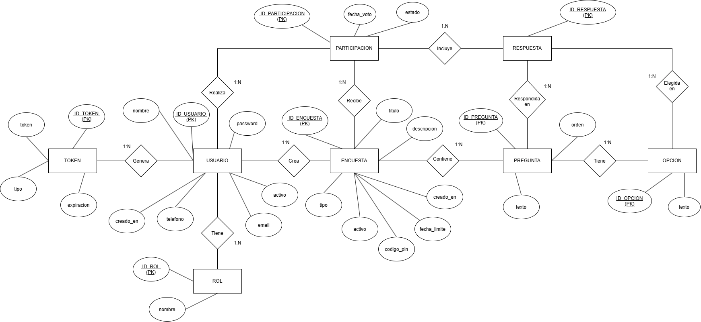

<div align="center">

# NextVoto

### Sistema Web de Gestión de Votaciones y Encuestas

**Materia:** Programación Web

**Integrantes:**<br>
Irving José Pérez Gris<br>
Fernández López Jazmín<br>
Sandoval Reyes Miguel

[Repositorio](https://github.com/IrvingJosePG/Nextvoto) ·
[Proyecto desplegado](https://nextvoto.lat) ·
[GitHub Projects](https://github.com/users/IrvingJosePG/projects/1) ·
[Prototipo en Figma](https://www.figma.com/design/rvq9m6FT1Pln9oJB62RW2k/Act7_Mockup_Equipo?node-id=1-2&t=Hff8UcLxNUEqbYr3-1)

</div>

---

## Índice

- [Descripción del proyecto](#descripción-del-proyecto)
- [Problemática que resuelve](#problemática-que-resuelve)
- [Diseño visual (Figma)](#diseño-visual-figma)
- [Módulos principales](#módulos-principales)
- [Roles del sistema](#roles-del-sistema)
- [Tecnologías utilizadas](#tecnologías-utilizadas)
- [Funciones principales](#funciones-principales)
- [Base de datos](#base-de-datos)
- [Instalación del proyecto](#instalación-del-proyecto)
- [Credenciales de prueba](#credenciales-de-prueba)
- [API](#api)
- [Pruebas con Bruno](#pruebas-con-bruno)
- [Comunicación con el usuario](#comunicación-con-el-usuario)
- [Despliegue](#despliegue)
- [Enlaces](#enlaces)

---

## Descripción del proyecto

**NextVoto** es una plataforma web diseñada para crear, administrar y ejecutar procesos de votación y encuestas academicas de manera segura y transparente.

El sistema gestiona el ciclo completo de participación mediante control de acceso basado en roles (**Administrador**, **Moderador** y **Votante**), generación de códigos PIN de acceso, validación de voto único por participante, resultados estadísticos en tiempo real y notificaciones automatizadas por correo electrónico y WhatsApp.

## Problemática que resuelve

En entornos académicos e institucionales, muchas consultas y elecciones internas aún se realizan mediante conteos manuales que carecen de control de identidad, permiten respuestas duplicadas y dificultan la trazabilidad de los resultados.

**NextVoto** resuelve esta problemática garantizando que únicamente usuarios autorizados participen en cada encuesta o votación, impidiendo el doble voto mediante restricciones, protegiendo las sesiones con tokens y ofreciendo paneles de supervisión y resultados inmediatos.

## Diseño visual (Figma)

- **Prototipo navegable:** Disponible en [Figma](https://www.figma.com/design/rvq9m6FT1Pln9oJB62RW2k/Act7_Mockup_Equipo?node-id=1-2&t=Hff8UcLxNUEqbYr3-1) con los flujos interactivos para **Administrador**, **Moderador** y **Votante**, incluyendo inicio de sesión, registro y recuperación de cuenta.
- **Paleta de colores:** Se aplicadan colores a sistemas institucionales. El azul primario (`#1558BC`) y sus variantes claras (`#D9EBFF`) transmiten confianza y seriedad, se combinan con fondos neutros (`#FFFFFF` y `#F8FAFC`) para maximizar la legibilidad.

## Módulos principales

| Módulo | Descripción |
| :--- | :--- |
| **Autenticación y Seguridad** | Gestiona el registro, inicio de sesión con **JWT**, cierre de sesión con invalidación de token (*blacklist*), encriptación **BCrypt** y recuperación de contraseña mediante código PIN temporal. |
| **Panel de Administración** | Permite supervisar métricas globales del sistema, administrar cuentas de usuario (búsqueda paginada en servidor, creación, cambio de rol, suspensión/reactivación) y gestionar encuestas activas. |
| **Encuestas y Votaciones** | Permite a los moderadores crear encuestas con múltiples preguntas y opciones, generar PIN de acceso, abrir o cerrar periodos de votación y consultar resultados. |
| **Portal del Votante** | Permite canjear códigos PIN, visualizar encuestas disponibles, emitir un voto único por encuesta y consultar el historial personal de participación. |
| **Notificaciones Multicanal** | Envía códigos de verificación y avisos reales por **correo electrónico** (Postfix en VPS) y **WhatsApp** (CallMeBot API). |

## Roles del sistema

| Rol | Permisos |
| :--- | :--- |
| **Administrador** | Acceso total al sistema, métricas globales, CRUD y gestión de estado/roles de todos los usuarios, y supervisión o cierre de cualquier encuesta. |
| **Moderador** | Creación y configuración de encuestas o votaciones, definición de preguntas/opciones, generación de PIN de participación, cierre y consulta de resultados. |
| **Votante** | Acceso a encuestas asignadas o mediante PIN, emisión de voto único y consulta de historial de participación. |

## Tecnologías utilizadas

**Backend:** Java 17 · Spring Boot 4.1.2 · Spring Security · JWT (JJWT 0.12.6) · Spring Data JPA / Hibernate · Bean Validation · Flyway<br>
**Frontend:** React · Vite · Tailwind CSS · CSS3 · Axios · Lucide React<br>
**Base de datos:** MySQL 8<br>
**Comunicación:** Postfix SMTP + JavaMailSender (SPF/DKIM) · CallMeBot API (WhatsApp)<br>
**Infraestructura y Herramientas:** VPS Linux · Nginx · Certbot · Systemd · Git · GitHub · Figma · Bruno

## Funciones principales

- Registro e inicio de sesión con validación de seguridad en contraseña (mínimo 8 caracteres, mayúscula, número y carácter especial)
- Autenticación stateless mediante **JWT** con invalidación de token al cerrar sesión
- Control de acceso por roles en backend (`SecurityFilterChain` / `@PreAuthorize`) y rutas protegidas en React
- Recuperación de contraseña mediante PIN temporal enviado por correo electrónico o WhatsApp
- Gestión integral de usuarios con paginación y filtros ejecutados del lado del servidor
- Suspensión y reactivación lógica de cuentas preservando la integridad del historial de votos
- Creación de encuestas multipregunta y emisión de voto único por participante
- Visualización de métricas y resultados de participación
- Colección completa de pruebas automatizadas de endpoints en **Bruno**

## Base de datos

El proyecto utiliza **MySQL 8** con control de versiones de esquema y datos semilla administrados mediante **Flyway** (`V1` y `V2`). El modelo relacional consta de **8 tablas normalizadas**.

**Tablas principales:**

```text
roles · usuarios · tokens · encuestas
preguntas · opciones · participaciones · respuestas
```

### Diagrama Entidad-Relación (DER)


### Modelo Relacional


- **Script de respaldo (.sql):** [`./docs/respaldo_nextvoto.sql`](./docs/respaldo_nextvoto.sql)

## Instalación del proyecto

### 1. Clonar el repositorio

```bash
git clone https://github.com/IrvingJosePG/Nextvoto.git
cd Nextvoto
```

### 2. Base de datos y Backend (Spring Boot)

Crea la base de datos en **MySQL 8**:

```sql
CREATE DATABASE nextvoto_final_db CHARACTER SET utf8mb4 COLLATE utf8mb4_unicode_ci;
```

Genera el archivo de propiedades locales a partir de la plantilla incluida en el repositorio:

```bash
cp backend/src/main/resources/application.properties.example backend/src/main/resources/application.properties
```

Configura en `application.properties` tus credenciales locales de MySQL, una clave `jwt.secret` en Base64 de al menos 256 bits y las variables de correo (`spring.mail.*`), WhatsApp (`callmebot.api.*`) y SMS.

Inicia el servidor backend (Flyway ejecutará las migraciones y cargará los datos iniciales automáticamente):

```bash
cd backend
./mvnw spring-boot:run
```

El backend quedará disponible en:

```text
http://localhost:8080
```

### 3. Frontend (React)

```bash
cd frontend
npm install
npm run dev
```

La aplicación web estará disponible en:

```text
http://localhost:5173
```

## Credenciales de prueba

Las cuentas precargadas por las migraciones de Flyway utilizan la contraseña **`NextVoto2026!`**:

| Rol | Correo | Contraseña | Permisos principales |
| --- | --- | --- | --- |
| **Administrador (Fijo)** | `admin@nextvoto.com` | `NextVoto2026!` | Control total del sistema, gestión de usuarios, roles y encuestas |
| **Moderador** | `carlos.mendoza@nextvoto.com` | `NextVoto2026!` | Creación de encuestas, generación de PIN, cierre y resultados |
| **Votante** | `miguel@nextvoto.com` | `NextVoto2026!` | Canjeo de PIN, emisión de voto único e historial personal |

## API

**URL base en producción:**

```text
https://nextvoto.lat/api
```

**URL base en desarrollo local:**

```text
http://localhost:8080/api

```

**Endpoints principales:**

| Método | Ruta | Descripción |
| --- | --- | --- |
| `POST` | `/api/auth/register` | Registro de nuevo usuario votante |
| `POST` | `/api/auth/login` | Inicio de sesión y emisión de token JWT |
| `POST` | `/api/auth/logout` | Cierre de sesión e invalidación del token JWT |
| `POST` | `/api/auth/recuperar` | Solicitud de código PIN de recuperación (correo o WhatsApp) |
| `POST` | `/api/auth/restablecer` | Validación de PIN y actualización de contraseña |
| `GET` | `/api/admin/resumen` | Métricas globales del panel de administración |
| `GET` | `/api/admin/usuarios` | Listado de usuarios |
| `POST` | `/api/admin/usuarios` | Creación de usuario |
| `PATCH` | `/api/admin/usuarios/{id}/rol` | Cambio del rol de un usuario |
| `PATCH` | `/api/admin/usuarios/{id}/estado` | Suspensión o reactivación de cuenta de usuario |
| `DELETE` | `/api/admin/usuarios/{id}` | Eliminación de un usuario |
| `GET` | `/api/admin/encuestas` | Supervisión global de encuestas y participaciones |
| `PATCH` | `/api/admin/encuestas/{id}/cerrar` | Cierre de una encuesta |
| `DELETE` | `/api/admin/encuestas/{id}` | Eliminación de una encuesta |
| `POST` | `/api/votante/unirse` | Incorporación a una encuesta mediante PIN |
| `GET` | `/api/votante/pendientes` | Consulta de participaciones pendientes |
| `GET` | `/api/votante/historial` | Consulta paginada del historial de participación |
| `GET` | `/api/votante/encuestas/{id}` | Consulta de la boleta de una encuesta |
| `POST` | `/api/votante/encuestas/{id}/votar` | Emisión del voto en una encuesta |
| `GET` | `/api/votante/encuestas/{id}/resultados` | Consulta de resultados de una encuesta |

Las rutas protegidas requieren el encabezado de autorización:

```text
Authorization: Bearer TOKEN
```

## Pruebas con Bruno

La colección de pruebas de la API se encuentra versionada dentro de la carpeta [`./bruno`](./bruno) de este repositorio, cubriendo:

* Registro e inicio de sesión (`POST /api/auth/login`) con obtención de token JWT
* Consumo de endpoints protegidos enviando el encabezado `Authorization: Bearer <token>`
* Consultas paginadas y filtradas en el módulo de administración
* Flujo de solicitud y restablecimiento de contraseña
* Casos de error por validación de campos (`400 Bad Request` / `422 Unprocessable Entity`)
* Casos de error por token ausente, expirado o invalidado (`401 Unauthorized`)
* Casos de recurso inexistente (`404 Not Found`)

## Comunicación con el usuario

* **Correo electrónico (Postfix + JavaMailSender):** Servidor SMTP propio configurado directamente en el VPS para garantizar la entrega en bandeja de entrada sin depender de servicios externos.
* **WhatsApp (CallMeBot API):** Integrado en `NotificacionService` mediante `HttpClient` de Java 17 para el envío automatizado de códigos PIN temporales de recuperación de cuenta.

## Despliegue

El sistema está desplegado en un **VPS Linux** propio sirviendo el frontend compilado como archivos estáticos mediante **Nginx**, el backend ejecutándose como servicio continuo con **Systemd**, base de datos **MySQL 8** local y certificado **SSL gratuito de Let's Encrypt** gestionado con **Certbot**.

| Recurso | Dirección |
| --- | --- |
| **Sitio web (HTTPS)** | `https://nextvoto.lat` |
| **URL base de la API** | `https://nextvoto.lat/api` |

## Enlaces

| Recurso | Link |
| --- | --- |
| **Repositorio de GitHub** | https://github.com/IrvingJosePG/Nextvoto |
| **GitHub Projects (Público)** | https://github.com/users/IrvingJosePG/projects/1 |
| **Proyecto desplegado** | https://nextvoto.lat |
| **Prototipo de Figma** | https://www.figma.com/design/rvq9m6FT1Pln9oJB62RW2k/Act7_Mockup_Equipo?node-id=1-2&t=Hff8UcLxNUEqbYr3-1 |

---

**Irving José Pérez Gris** · **Fernández López Jazmín** · **Sandoval Reyes Miguel**